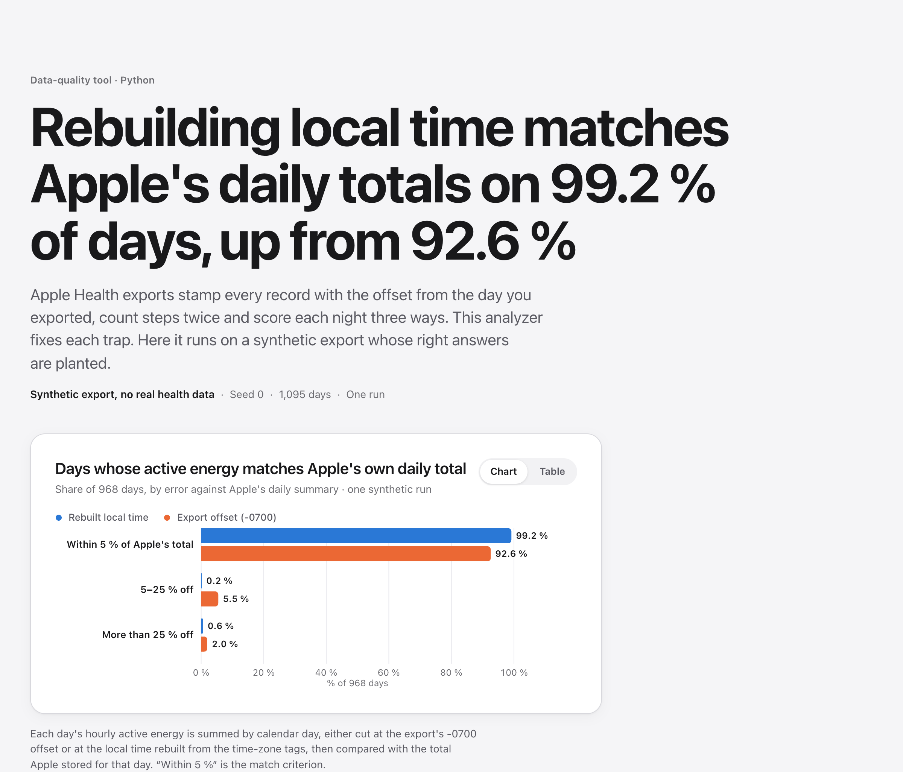

# health-export-lab

A local analyzer for Apple Health exports that fixes what the raw export gets wrong before running any statistics. Sum the steps naively and you count iPhone and Watch twice; read the timestamps literally and trips land in the wrong time zone.



Report: https://allenwang0.github.io/health-export-lab/

All screenshots and numbers come from a synthetic export with known answers, not real health data.

## Highlights

- Steps counted once: a plain sum gives 13,913,705 steps; removing iPhone and Watch overlap recovers the true 8,047,907 exactly.
- Local time rebuilt hour by hour: days matching Apple's own daily totals go from 92.6% to 99.2%.
- Every fix is proven necessary: reverting each of 14 fixes, one at a time, makes a test fail.
- Streams the export zip without extracting it and parses a synthetic 1,000,000-record export in about 10 s on a laptop.

## Run it

Requires Python 3.11.

```bash
make setup                        # virtualenv with pinned dependencies
make demo                         # synthetic export, served at http://127.0.0.1:8877
make test
./run.sh ~/Downloads/export.zip   # your own export from the Health app
```

## How it works

- Parses the export zip as a stream and keeps every value as raw text.
- Rebuilds local time from Apple's time-zone tags, since every record carries the offset from the day you exported.
- Removes overlap between sources in priority order (Watch, iPhone, other apps) and picks one sleep source per night.
- Treats days with no data as unknown, never zero.
- Runs a fixed set of statistical tests chosen in advance and corrects for testing many at once; all 4 that survive reflect the one effect the generator planted.

## Limitations

- Runs locally, nothing uploaded: the server only answers on 127.0.0.1 and your original export is never modified.
- Time-zone changes are placed to within about a day.
- Questions are matched by rules, not a language model, so only a fixed set of question shapes works.
