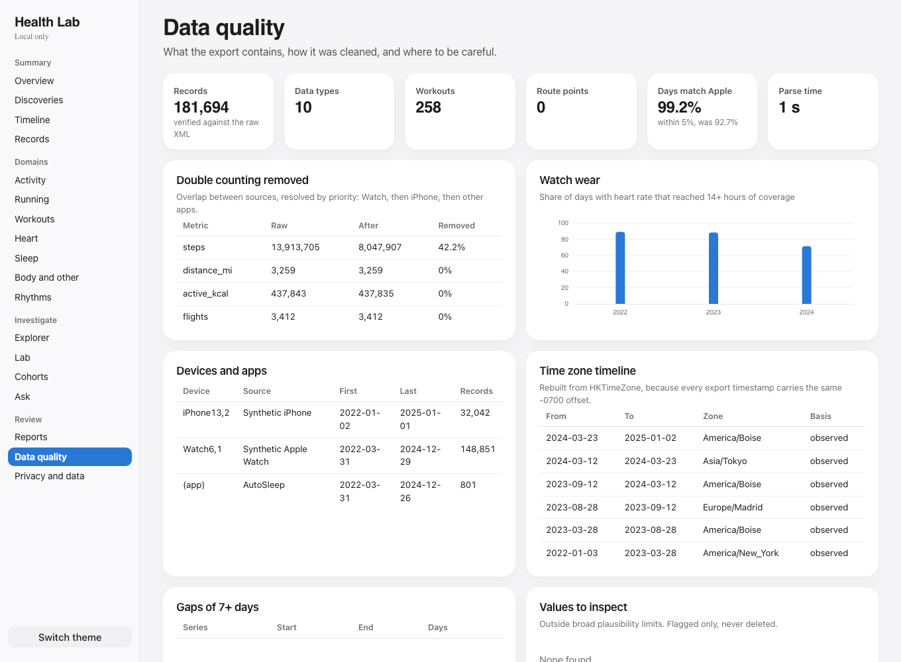

# Health Lab

A local analyzer for an Apple Health export. It repairs what the export gets wrong (time zones, double counting, sleep sources, wear gaps) before running any statistics. A synthetic export reproduces each of those problems, and a test for each one fails if its fix is removed.


Every screenshot and number in this README comes from the synthetic export in `healthlab/synth.py` (seed 0, 1,095 days). None of it is real health data.

## Quickstart

Python 3.11 is required (`make setup PYTHON=/path/to/python3.11` if it is not on your PATH as `python3.11`).

```bash
make setup     # .venv with pinned dependencies
make demo      # writes a synthetic export to demo-data/, imports it, serves http://127.0.0.1:8877
make test      # 44 tests, about 40 seconds
make lint      # ruff
make mutants   # removes each trap fix in turn and requires its test to fail, about 4 minutes
make report    # report/index.html, site/card.json
```

To analyze your own export, use Health app > profile > Export All Health Data, then:

```bash
./run.sh ~/Downloads/export.zip   # imports into data/, analyzes, serves
./run.sh                          # serves what is already imported
```

Set `PORT` to use another port. `HEALTHLAB_DATA` points the app at another data directory; `make demo` uses `demo-data/`, so it never touches a real import.


## The traps, measured

`python -m healthlab.synth out/export.zip` writes `apple_health_export/export.xml` in Apple's element shape (Record, Workout with WorkoutStatistics and WorkoutEvent, ActivitySummary, Correlation, HeartRateVariabilityMetadataList), plus `truth.json` with what it planted. The default export has 181,694 records, 258 runs and 968 activity summaries. Generating, parsing and building it takes 7.0 s on an Apple M5 Pro. The table comes from `make report` on that export.

| Trap | Naive answer | Health Lab | Planted truth |
|---|---|---|---|
| iPhone and Watch count the same steps | 13,913,705 steps (plain sum) | 8,047,907 | 8,047,907 |
| Every timestamp carries the -0700 export offset | 92.6% of days within 5% of Apple's daily total | 99.2% | 100%; all 8 misses fall within 2 days of a zone change |
| Watch, AutoSleep and iPhone each score the night | 8.14 h (longest source) | 6.98 h | 6.98 h |
| Five days with no data at all | 5 days of 0 steps | 5 days NULL | 5 unknown days |
| Older runs keep about 4 heart-rate samples | 124 runs with an average | 124 runs left blank | 124 runs |
| A move, two trips and a `US/Eastern` alias | 1 zone | 6 zone segments | 6 tagged eras |
| Watch worn only part of the day | 113 partial days counted as worn | 113 excluded from worn-day series | 113 partial days |

**Time.** Apple writes every timestamp with the UTC offset in force at export, not at recording. The instant is right but the wall clock is wrong in winter and on trips. `build.hour_offsets` rebuilds local time hour by hour from `HKTimeZone` tags, with DST resolved by `zoneinfo`. `build.validate_time` checks the result against Apple's own ActivitySummary days, which are keyed by the true local date. Before the first tag the earliest tagged zone is assumed, and those days are marked `assumed`. The synthetic export starts with such an era, lived one zone west, so the label is tested.

**Double counting.** iPhone and Watch record the same steps. `build.dedupe_cumulative` removes overlap interval by interval in priority order (Watch, iPhone, then other apps) and assumes a uniform rate within a sample. Lower-priority sources still fill time the higher ones left empty.

**Sleep.** Each night uses the best available source: Watch stages, Watch, AutoSleep, Sleep Cycle, Mi Fit, then in-bed records. The chosen source is named, and sources are never averaged. A night belongs to the date you wake up. Device names contain a non-breaking space, which source matching normalizes.

**Wear.** A day counts as worn only with 14 or more hours of heart-rate coverage. Daily totals that depend on wear have a worn-days-only series.

**Missing data.** A day without samples is NULL, never zero. A workout average heart rate needs a workout statistic or at least 20 samples.

**Exports are cumulative.** Re-importing records that were already seen adds nothing. Blood pressure readings nested in a Correlation are kept as correlation members and are not also counted as samples.

## How each fix is tested

- `tests/test_traps.py` (13 tests) builds the synthetic export once and compares the analyzer's output with the planted truth, trap by trap. Days next to a zone change are left out of per-day checks, because tags place a change only to within about a day.
- `scripts/mutation_check.py` applies 14 one-line patches, each restoring the naive behaviour (for example, cutting every day at -0700, or letting the longest sleep source win), in a scratch copy. It then requires the matching test to fail. Current result: 14 of 14 killed (`results/mutants.json`). The first run of this check found a re-import test that passed with the fix removed, because duplicate steps were also hidden by within-source dedupe. The test now compares heart-rate sample counts as well.
- `tests/test_properties.py` (7 Hypothesis tests): dedupe never creates value, its output segments never overlap, a single non-overlapping source is kept whole, a covering top-priority source wins exactly, splitting into hours preserves totals, span union is disjoint and covers the same points, and hourly offsets match `zoneinfo` in five zones.
- `tests/test_pipeline.py` (23 tests) covers the statistics, the hypothesis parser and the API's local-only guard on a smaller fixture. One of them parses 1,000,000 records and must finish in under 60 s (10.6 s measured).
- `tests/test_report.py` checks the report and `site/card.json` from a short run.

## How it works

| Stage | File | What it does |
|---|---|---|
| Parse | `healthlab/parse.py` | Streams the zip without extracting it. Keeps every value as a raw string in Parquet. |
| Normalize | `healthlab/build.py` | Rebuilds local time, removes overlap between sources, picks one sleep source per night, writes `lab.duckdb`. |
| Statistics | `healthlab/stats.py` | Effective sample size, block bootstrap, Newey-West regression, change points, FDR. |
| Discovery | `healthlab/insights.py`, `deep.py` | A fixed family of tests, plus event studies against placebo dates. |
| Questions | `healthlab/lab.py`, `ask.py` | Rule-based question parsing that runs the analyses. No language model is involved. |
| Serve | `healthlab/api.py`, `web/` | Local API and a plain JavaScript interface with a vendored copy of ECharts. |



## Reading the evidence

- Each metric is labeled observed, estimate or derived (`healthlab/catalog.py`).
- Grades: A means q < .01 with n >= 30, B means q < .05, C is tentative or null.
- Cross-metric tests are listed before any result is seen, and all of them count toward the false discovery correction, nulls included. On the synthetic export, 4 of 33 pairs reach q <= .10. All four are the one effect the generator plants (resting heart rate 2 bpm lower in the two days after a run), seen through running distance, workout minutes and active energy.

## Privacy

The server binds to 127.0.0.1 and rejects other Host and Origin headers. There is no telemetry, no access log and no remote code, font or map tile. Imported data stays in `data/`, which git ignores. Your original export is never changed. Nothing here is medical advice.

## Limitations

- Zone changes are placed to within about a day, at the first tagged record in the new zone.
- Before the first `HKTimeZone` tag the earliest tagged zone is assumed, so those hours can be off by the difference.
- A time zone stands in for a place, and each place is also a period of life.
- Heart-rate drift and route views need GPX routes; the synthetic export has none, so those views are empty in the demo.
- The synthetic export covers the traps above, not every record type Apple writes. `export_cda.xml` is not parsed, and ECG waveforms are counted but not shown.
- Ask is rule-based, so it handles a fixed set of question shapes.

## License

MIT, see `LICENSE`. `web/vendor/echarts.min.js` is Apache ECharts 5.6.0 under the Apache License 2.0.
