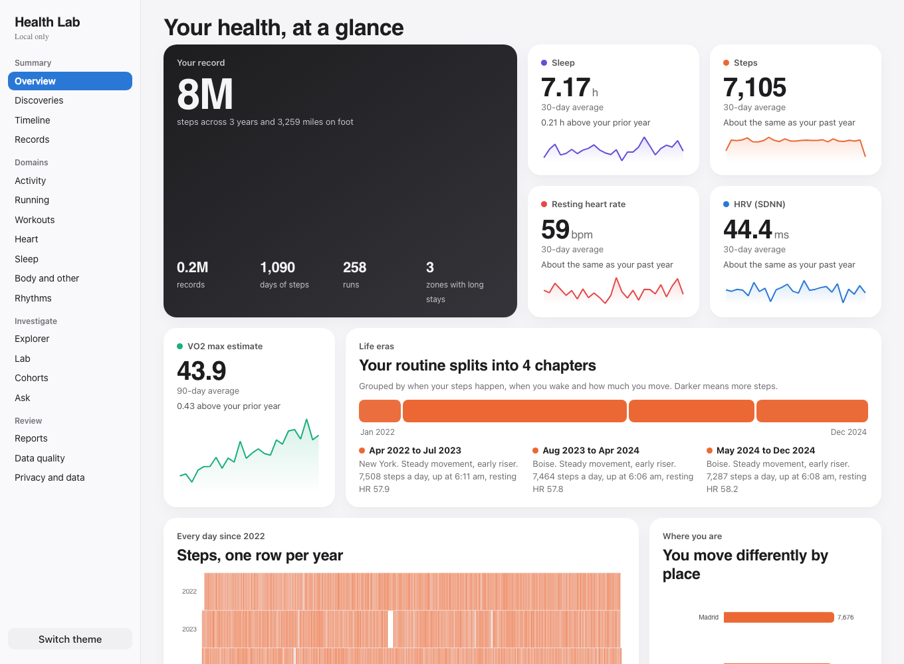

# health-export-lab

A local analyzer for Apple Health exports that fixes what the raw export gets wrong before running any statistics. Sum the steps naively and you count iPhone and Watch twice; read the timestamps literally and trips land in the wrong time zone. Each fix is checked against a synthetic export with known answers.


All screenshots and numbers here come from a synthetic export (`healthlab/synth.py`, seed 0, 1,095 days). None of it is real health data.

## Highlights

- **Steps counted once.** A plain sum gives 13,913,705 steps; interval-level deduplication across iPhone, Watch and apps recovers the true 8,047,907 exactly.
- **Local time rebuilt hour by hour.** Days matching Apple's own daily totals go from 92.6% to 99.2%; every remaining miss is within 2 days of a time-zone change.
- **Every fix is proven necessary.** A mutation check reverts each of 14 fixes to the naive behavior, one at a time, and a test catches all 14.
- **Fast:** streams the export zip without extracting it and parses 1,000,000 records in 10.6 s.
- **Honest statistics.** Of 33 cross-metric tests fixed in advance, 4 survive false-discovery correction, and all 4 are the one effect the generator planted.

## Quickstart

Requires Python 3.11 (`make setup PYTHON=/path/to/python3.11` if it isn't on your PATH).

```bash
make setup     # .venv with pinned dependencies
make demo      # builds a synthetic export, imports it, serves http://127.0.0.1:8877
make test      # 44 tests, about 40 seconds
make mutants   # reverts each fix and requires its test to fail, about 4 minutes
```

For your own data, export from the Health app (profile > Export All Health Data), then:

```bash
./run.sh ~/Downloads/export.zip   # imports into data/, analyzes, serves
./run.sh                          # serves what is already imported
```

`make demo` uses `demo-data/`, so it never touches a real import.



## The traps, measured

The synthetic export mirrors Apple's XML format with 181,694 records and writes `truth.json` describing every problem it planted.

| Trap | Naive answer | Health Lab | Planted truth |
|---|---|---|---|
| iPhone and Watch count the same steps | 13,913,705 steps (plain sum) | 8,047,907 | 8,047,907 |
| Every timestamp carries the -0700 export offset | 92.6% of days within 5% of Apple's daily total | 99.2% | 100%; all 8 misses fall within 2 days of a zone change |
| Watch, AutoSleep and iPhone each score the night | 8.14 h (longest source) | 6.98 h | 6.98 h |
| Five days with no data at all | 5 days of 0 steps | 5 days NULL | 5 unknown days |
| Older runs keep about 4 heart-rate samples | 124 runs with an average | 124 runs left blank | 124 runs |
| A move, two trips and a `US/Eastern` alias | 1 zone | 6 zone segments | 6 tagged eras |
| Watch worn only part of the day | 113 partial days counted as worn | 113 excluded from worn-day series | 113 partial days |

**Time.** Apple stamps every record with the UTC offset in force at export, not at recording, so the instant is right but the wall clock is wrong in winter and on trips. `build.hour_offsets` rebuilds local time hour by hour from `HKTimeZone` tags, resolving DST with `zoneinfo`. `build.validate_time` checks the result against Apple's ActivitySummary days, which use the true local date. Days before the first tag assume the earliest tagged zone and are labeled `assumed`.

**Double counting.** `build.dedupe_cumulative` removes overlap interval by interval in priority order (Watch, iPhone, then other apps), assuming a uniform rate within each sample. Lower-priority sources still fill gaps the higher ones left.

**Sleep, wear and gaps.** Each night uses the single best source (Watch stages first, in-bed records last), never an average, and belongs to the date you wake up. A day counts as worn only with 14+ hours of heart-rate coverage. Days without samples are NULL, never zero, and re-importing a cumulative export adds nothing.

## Testing

`tests/test_traps.py` compares output with the planted truth trap by trap, and `scripts/mutation_check.py` reverts each of 14 fixes (say, cutting every day at -0700) and requires a test to fail; results are in `results/mutants.json`. Its first run found a re-import test that passed with the fix removed, which now also checks heart-rate sample counts. Hypothesis property tests check that deduplication never creates value or overlapping segments and that hourly offsets match `zoneinfo`. The pipeline tests include a 1,000,000-record parse with a 60 s budget.

## How it works

| Stage | File | What it does |
|---|---|---|
| Parse | `healthlab/parse.py` | Streams the zip without extracting it. Keeps every value as a raw string in Parquet. |
| Normalize | `healthlab/build.py` | Rebuilds local time, removes overlap between sources, picks one sleep source per night, writes `lab.duckdb`. |
| Statistics | `healthlab/stats.py` | Effective sample size, block bootstrap, Newey-West regression, change points, FDR. |
| Discovery | `healthlab/insights.py`, `deep.py` | A fixed family of tests, plus event studies against placebo dates. |
| Questions | `healthlab/lab.py`, `ask.py` | Rule-based question parsing that runs the analyses. No language model is involved. |
| Serve | `healthlab/api.py`, `web/` | Local API and a plain JavaScript interface with a vendored copy of ECharts. |

Every metric is labeled observed, estimate or derived. Findings are graded A (q < .01 with n >= 30), B (q < .05) or C (tentative or null). Cross-metric tests are fixed before any result is seen, and all of them, nulls included, count toward the false discovery correction. On the synthetic export the 4 survivors (of 33 pairs, q <= .10) all reflect the planted effect, resting heart rate 2 bpm lower in the two days after a run.


## Privacy

The server binds to 127.0.0.1 and rejects other Host and Origin headers. There is no telemetry, no access log, and nothing loaded from the network. Imported data stays in `data/`, which git ignores, and your original export is never modified. Nothing here is medical advice.

## Limitations

- Zone changes are placed to within about a day, and hours before the first `HKTimeZone` tag can be off by the zone difference.
- The synthetic export covers the traps above, not every record type. `export_cda.xml` is not parsed, ECG waveforms are counted but not shown, and route views are empty in the demo because it has no GPX routes.
- Questions are rule-based, so only a fixed set of question shapes works.

## License

MIT, see [LICENSE](LICENSE). `web/vendor/echarts.min.js` is Apache ECharts 5.6.0 under the Apache License 2.0.
